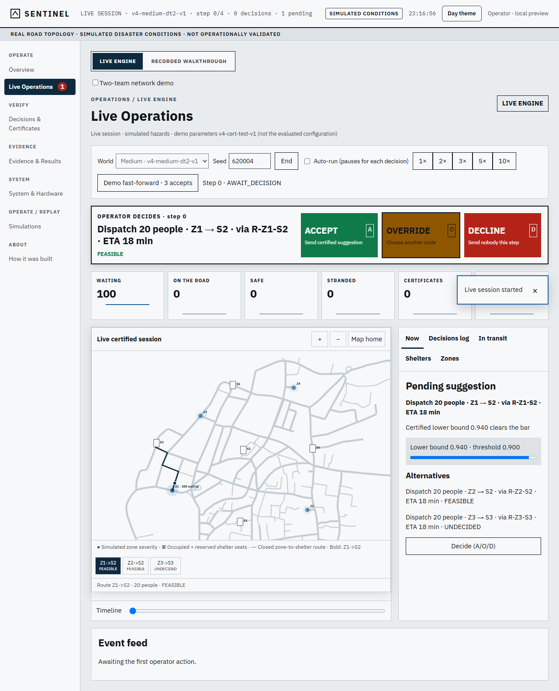
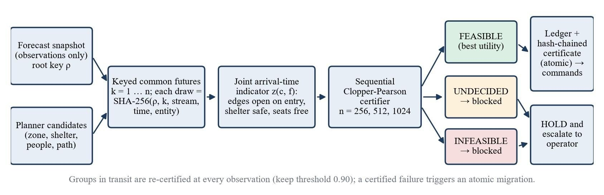
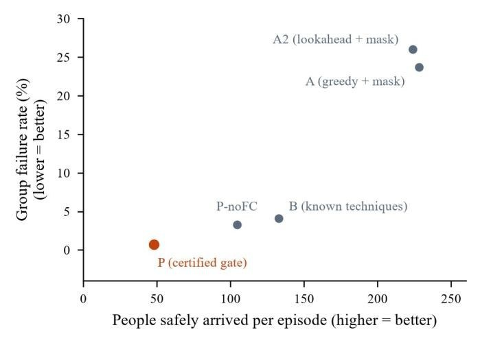
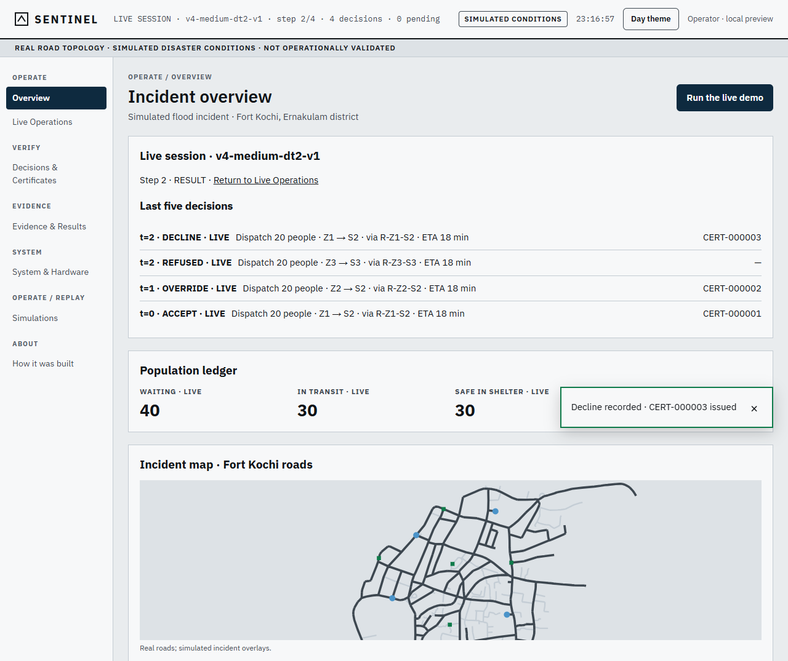
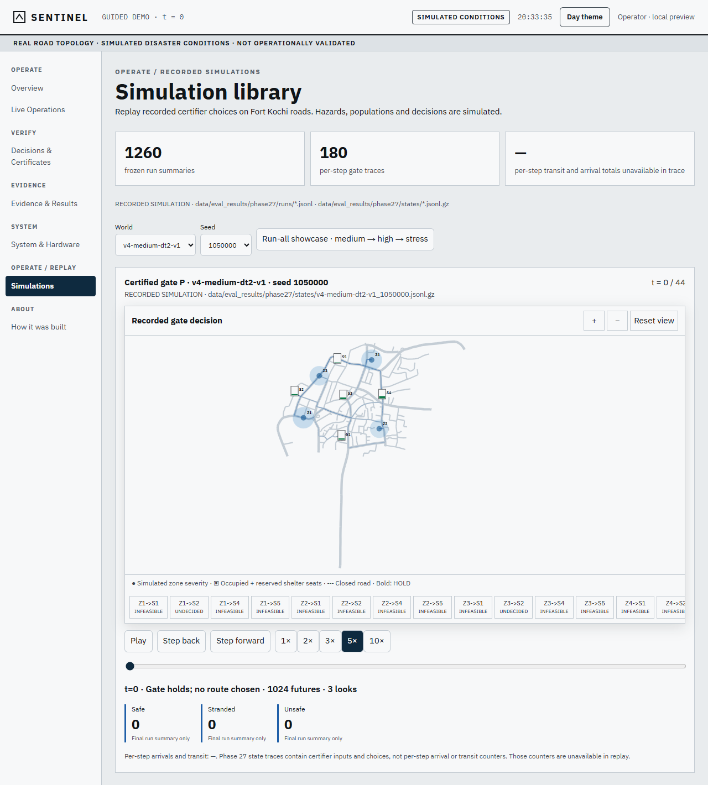

# Sentinel — certified dispatch for flood evacuation

Sentinel is a decision-support prototype for flood evacuation. It runs on the **real road network of Fort Kochi,
Kerala** with **simulated flood hazards**, and helps an operator decide which waiting group to send, to which
shelter, by which road, and when.

Its core is a **certified dispatch gate**: a dispatch is allowed only if the system can show, with a statistical
bound, that the *whole trip* is likely to succeed. That means the road stays open while the group is on it, the
shelter is still safe when they arrive, and there are still seats left. The operator always makes the final call.



> Research prototype. The roads are real; the hazards, populations, shelters, closures and devices are simulated.
> It has not been used or validated in a real emergency.

---

## The problem

Most evacuation tools check whether a road and a shelter are safe **at the moment of dispatch**. But a group
meets the road and the shelter **later**. On the way, a road can flood and close, the shelter can become unsafe,
and walk-in evacuees can take the free seats before the group arrives.

The project asks two questions:

1. Can every dispatch be held to a statistical guarantee about what happens **on arrival**?
2. Does holding every dispatch to that guarantee actually make evacuations better?

## How the gate works



1. **Keyed futures.** From the current observation, the gate generates many possible flood futures. Every random
   draw comes from a SHA-256 key, so all candidates are compared on the same futures and any decision can be
   replayed exactly.
2. **Joint arrival-time check.** For each candidate dispatch and each future, the group is followed along its route
   to its own arrival time. The trip counts as a success only if every road segment is open when entered, the
   shelter is safe on arrival, and seats are free on arrival, all in the same future.
3. **Fail-closed certification.** The gate checks 256, then 512, then 1,024 futures and computes a one-sided
   Clopper–Pearson lower bound on the success probability. A dispatch is **FEASIBLE** only if that bound reaches
   0.95. Anything the gate cannot prove is blocked.
4. **Certificate and replay.** A committed dispatch is written to the capacity ledger together with a
   hash-chained certificate in one transaction. Anyone can regenerate the futures from the certificate and get the
   same decision bit for bit. Groups already on the road are re-checked every step and rerouted if their trip is
   certified to fail.

---

## Research and results

The project ran in two stages. Both were evaluated against strong baselines under plans fixed in advance, and
negative results are reported as they came out.

### Stage 1: does reinforcement learning beat planning?

We trained a MaskablePPO agent (five seeds) and compared it with classical planners on **600 unseen scenarios**
(200 each at low, medium and high uncertainty) plus 250 stress scenarios.

| Policy | NSU (higher is better) | Safe population | Exposure | CVaR₁₀ |
|---|---:|---:|---:|---:|
| Random valid | 0.000 | 0.660 | 1839.7 | 0.0004 |
| Nearest safe | 0.762 | 0.732 | 1384.4 | 0.0325 |
| Risk greedy | 1.000 | 0.760 | 1456.0 | 0.0509 |
| Lookahead-2 | 1.475 | 0.824 | 1322.8 | 0.1012 |
| Lookahead-3 | **1.531** | 0.830 | 1318.6 | 0.1030 |
| MPC | 1.459 | **0.831** | 1469.2 | 0.1020 |
| MaskablePPO (5 seeds) | 0.209 | 0.683 | 1817.5 | 0.0038 |

**Finding:** the learned policy did not beat simple planners. Against risk-greedy it scored 0.79 NSU lower
(95 % CI [−0.84, −0.75]) with 24.8 % higher exposure, and it failed the usefulness test in every uncertainty level
and stress test. We kept this result instead of retraining until it won, and built the gate around a planner
instead.

### Stage 2: the certified gate

The gate was evaluated in a **pre-registered** study: the plan, the systems and four pass/fail bars were written
and locked with a SHA-256 hash before any run. In total there were **7 systems × 3 hazard regimes × 60 seeds =
1,260 episodes**, plus an oracle study that graded up to 400 decision states on 4,096 independent futures.

| Bar | Test | Result | Pass |
|---|---|---|:---:|
| 1. Outcomes | Lower failure rate **and** at least 95 % of the people delivered | Failure rate −0.230 [−0.264, −0.197], but only 21.4 % of the people | ✗ |
| 2. Coupling | Joint check makes fewer errors than separate checks (McNemar) | 179 vs 243 errors, p = 1.08 × 10⁻¹⁹ | ✓ |
| 3. Keyed futures | Variance reduced at least 2× | 1.071× | ✗ |
| 4. Safety | False accepts in at most 1 % of states | 0 of 400 (upper bound 0.0075) | ✓ |

| System (primary regimes, per episode) | Groups sent | People delivered safely | Group failure rate |
|---|---:|---:|---:|
| A: greedy planner + current mask | 16.6 | 228.1 | 23.7 % |
| A2: lookahead planner + mask | 16.6 | 223.8 | 26.0 % |
| B: known safety techniques combined | 8.2 | 132.9 | 4.1 % |
| **P: certified gate** | 3.3 | 47.9 | **0.7 %** |
| P without fail-closed blocking | 6.6 | 104.4 | 3.3 % |



**What we found:**

- **The safety side worked.** The gate never certified a dispatch that the oracle judged unsafe (0 of 400 states).
  Checking road, shelter and seats together in the same future wrongly blocked 26 % fewer good dispatches than
  checking them separately.
- **The outcome side did not.** The gate cut the group failure rate from 23.7 % to 0.7 %, but only by sending far
  fewer groups. It delivered 21.4 % of the people the lookahead planner delivered, so by the rule we fixed in
  advance **we do not claim it improves evacuations**.
- **The lesson:** a per-decision safety guarantee can be real and still be the wrong target. A gate meant for real
  use needs a system-level goal (people delivered, time at risk) as its acceptance test, not only per-trip safety.

Other measured results:

- **Replay:** 1,274 of 1,274 certified decisions from 64 episodes regenerated bit for bit from their certificates
  (using the fast test parameters).
- **Rerouting stability:** in a synthetic study (1,000 seeds × 40 steps), 854 reroutes never sent a group back to
  a shelter it had left, and no group was moved more than twice.
- **Guideline rules:** rules from the NDMA flood guidelines enter the gate only at the trust level their evidence
  earns. The claim-support checker scored macro-F1 0.970 on 135 claim–evidence pairs (an earlier version failed
  at 0.585 and is kept on record).
- **Latency (laptop, 256 futures):** certify-only 288 ms at the median, end to end 6.6 s at the median. Both
  latency targets were missed.

The full write-up is in [`docs/paper/paper.tex`](docs/paper/paper.tex). Every number in it is generated from
frozen result files by one script, which also writes a trace from each number to its source.

---

## The operator console

A React console on top of a FastAPI service, with live simulated sessions and recorded replays.

**Live Operations** (top of this page): pick a world and seed, run step by step or at 1×–10× speed, and decide each
certified suggestion with **Accept**, **Override** (to another certified route) or **Decline**. Overrides to an
uncertified action are refused and logged. Every decision updates the map, the counters, the overview and the
decision log, and issues a certificate.

**Incident overview:** the last decisions, the population ledger, shelters, gate activity and recent certificates.



**Simulation library:** replay any of the 1,260 recorded evaluation runs on the map, compare two systems on the
same world and seed, and browse every run.



Other pages show every decision with its certificate (replay or tamper-check it from the browser), the evidence and
results tables with their source files, and a simulated hardware-in-the-loop rig of ESP32 nodes (water level,
shelter head count, vehicle terminal) that talks over MQTT and refuses commands whose certificate does not verify.

---

## Tech stack

| Area | Tools |
|---|---|
| Simulation and routing | Python 3.12, NetworkX (Dijkstra on open roads), cached OpenStreetMap road graph |
| Learning | Gymnasium, Stable-Baselines3 / sb3-contrib (MaskablePPO) |
| Certification and statistics | SciPy (Clopper–Pearson, exact McNemar, bootstrap), SHA-256 keyed randomness |
| Retrieval over guidelines | BM25 plus MiniLM sentence embeddings (ChromaDB), fused by reciprocal rank fusion |
| Backend | FastAPI, Uvicorn |
| Frontend | React, TypeScript, Vite |
| Hardware rig | ESP32 nodes over MQTT (simulated publisher) |
| Testing | pytest: about 1,100 tests covering simulation, safety masks, certification, replay, API and console |

---

## Setup

You need **Python 3.12** and **Node 20+**. No API key, model training or embedding download is needed to run the
console.

**macOS / Linux**

```bash
git clone https://github.com/manoj291205/sentinel-flood-evacuation.git
cd sentinel-flood-evacuation
python3.12 -m venv .venv-runtime
.venv-runtime/bin/python -m pip install -r requirements-runtime.txt -r requirements-api.txt
cd web && npm ci && npm run build && cd ..
bash scripts/run_console.sh
```

Then open **http://127.0.0.1:8101/live**. If the port is taken, run `PORT=8103 bash scripts/run_console.sh`.

**Windows (PowerShell)**

```powershell
git clone https://github.com/manoj291205/sentinel-flood-evacuation.git
cd sentinel-flood-evacuation
py -3.12 -m venv .venv-runtime
.venv-runtime\Scripts\python.exe -m pip install -r requirements-runtime.txt -r requirements-api.txt
cd web; npm ci; npm run build; cd ..
$env:SENTINEL_WEB_DIST = (Resolve-Path web/dist).Path
.venv-runtime\Scripts\python.exe -m uvicorn src.api.app:create_app --factory --host 127.0.0.1 --port 8101
```

After the first setup, only the last command is needed to start it again. Use a single server worker, because live
sessions are kept in memory.

**Development mode** (API on port 8000 and a hot-reloading console on port 5173): `scripts/dev.ps1` on Windows or
`bash scripts/dev.sh` elsewhere. Add `-Mock` / `--mock` to run the console alone against an in-browser mock.

**Docker**

```bash
docker build -t sentinel-demo .
docker run -p 8000:8000 -e SENTINEL_DEMO_PASSWORD=choose-one sentinel-demo
```

**Tests**

```bash
python -m pip install -r requirements.txt
python -m pytest tests/ -q
```

---

## Repository layout

```text
src/
  sim/          flood world: hazards, closures, shelters, walk-ins, travel
  geospatial/   Fort Kochi road graph and routing
  planners/     nearest-safe, risk-greedy, lookahead, MPC
  env_v3/, training_v3/   RL environment and MaskablePPO training
  certify/      keyed futures, joint rollout, certifier, certificates, replay, re-certification
  rag/, constraints/      guideline retrieval and rule trust tiers
  api/          FastAPI service for the console
web/            React + Vite operator console
hil/            hardware-in-the-loop rig (ESP32 / MQTT)
data/           road data, NDMA guideline documents, frozen evaluation results
specs/          design specs and the pre-registered evaluation plan
docs/paper/     research paper source and generated tables
tests/          pytest suite
```

## Data

- **Real:** the Fort Kochi road network (OpenStreetMap, © OpenStreetMap contributors, ODbL) and the cited NDMA flood
  guideline documents.
- **Simulated:** flood hazards, populations, shelters and capacities, road closures, travel times, walk-ins and the
  hardware devices.
- **Measured:** only the evaluation results stored under `data/eval_results/` and `data/eval_v3/`.

## Team

B.Tech Project-I, School of Computer Science and Engineering (SCOPE), Vellore Institute of Technology.

- Manojkumar Ashokkumar
- Akshar Sinha
- Agathian
- Guide: Mohanasundaram R
